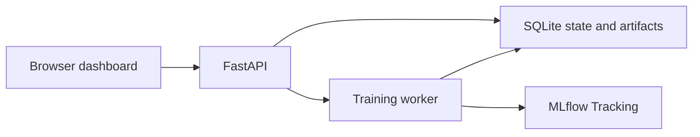

# ScamShift

ScamShift is an MLOps app that flags suspicious messages and compares active and retrained models against emerging Hinglish scam patterns.

## Architecture



FastAPI serves the vanilla HTML, CSS and JavaScript dashboard. Scans use the active SQLite model pointer and a cached scikit-learn pipeline. The background worker trains a candidate from a review snapshot, logs to MLflow, then registers the model and completes the job in the same SQLite transaction. The operator compares the candidate against the active model, approves a release only when its gates pass, and can restore a previously deployed model.

## Run locally

Use Python 3.12 for the KIET demo, CI and Docker. On Windows, `start-windows.cmd` also starts the original dashboard on port 8765. The launcher checks the interpreter and refreshes dependencies when `requirements.txt` changes.

| KIET phase | ScamShift walkthrough |
| --- | --- |
| 1 | Create `kiet-env`, train and save a baseline with `train.py`, then score messages through FastAPI. |
| 2 | Build the Docker image and check that a named volume preserves reviews and the active model. |
| 3 | Run pytest, the standalone smoke test and dashboard tests. GitHub Actions repeats verification and smoke-tests the image. |
| 4 | Inspect experiments and model versions in MLflow. Train a candidate, compare it in replay, promote it if the gates pass, then roll back. |

### Phase 1 · Train and serve a baseline

Run these commands from the project root in Windows PowerShell.

```powershell
python -m venv kiet-env
.\kiet-env\Scripts\Activate.ps1
python -m pip install -r requirements.txt
python train.py
$env:SCAMSHIFT_BOOTSTRAP_DIR = "$PWD/runtime/baseline"
$env:SCAMSHIFT_STATE = "$PWD/runtime/classroom"
python -m uvicorn main:app --host 127.0.0.1 --port 8765 --reload
```

If PowerShell blocks activation, replace `python` after creating the environment with `.\kiet-env\Scripts\python.exe`. On macOS or Linux, run the following commands.

```bash
python3.12 -m venv kiet-env
source kiet-env/bin/activate
python -m pip install -r requirements.txt
python train.py
export SCAMSHIFT_BOOTSTRAP_DIR="$PWD/runtime/baseline"
export SCAMSHIFT_STATE="$PWD/runtime/classroom"
python -m uvicorn main:app --host 127.0.0.1 --port 8765 --reload
```

`train.py` writes `runtime/baseline/classifier.pkl` and `runtime/baseline/evaluation.json`. Use `--output-dir` to pick another directory and point `SCAMSHIFT_BOOTSTRAP_DIR` to it. The report records the threshold, preprocessing mode and artifact checksum. The API imports the pair on first startup with empty state. Existing deployments and their history are kept in `SCAMSHIFT_STATE/scamshift.db` across restarts and training runs.

Open the [dashboard](http://127.0.0.1:8765/), [OpenAPI docs](http://127.0.0.1:8765/docs) and [readiness endpoint](http://127.0.0.1:8765/api/readiness). Readiness returns HTTP 503 if the app cannot serve an active artifact. In `/docs`, call `POST /api/scan` with `{"text":"The library closes at six today."}` and then `{"text":"Urgent: your account is blocked. Share OTP now."}`. Compare the response scores and flags at the reported threshold.

### Phase 2 · Build and run the container

Stop the local API before binding port 8765. These commands work in PowerShell and macOS/Linux shells.

```sh
docker build -t scamshift:kiet .
docker run -d --rm --name scamshift-kiet -p 127.0.0.1:8765:8765 -v scamshift-demo:/app/runtime scamshift:kiet
docker ps
docker logs scamshift-kiet
```

Wait for readiness, scan a synthetic message, and save one genuine review in the dashboard. Run `docker stop scamshift-kiet` and repeat `docker run`. Check the review count and active model in `/api/status`. First startup initializes a baseline from bundled data and writes SQLite and MLflow artifacts under `/app/runtime`. The volume persists these files for the non-root app user.

### Phase 3 · Verify locally and in GitHub Actions

```sh
python -m pip install -r requirements-dev.txt
python -m pytest -q
python smoke_test.py
node --check web/app.js
node --test test_dashboard.js
```

The smoke test uses an isolated temporary directory and covers inference, input validation, evaluation separation, training-job recovery, MLflow artifacts, promotion and rollback. The JavaScript regression tests cover review binding after delayed scans and the drift reporting form. GitHub Actions runs the checks on Linux and Windows, then checks container startup and volume persistence on Linux. Pull requests verify the image. Publication requires successful verification of a push to `main` in `Shrashti1234/ScamShift`.

### Phase 4 · Track experiments and deploy with MLflow

Run MLflow and the app in separate terminals from the repository root. Keep both bound to loopback. Start the MLflow server in an activated environment with `requirements.txt` installed.

In Windows PowerShell, use a local artifact URI. Run the API and MLflow server on the same machine so both can access it.

```powershell
New-Item -ItemType Directory -Force runtime/registry-artifacts | Out-Null
$artifactUri = ([uri](Resolve-Path runtime/registry-artifacts).Path).AbsoluteUri
python -m mlflow server --host 127.0.0.1 --port 5000 --workers 1 --backend-store-uri sqlite:///runtime/registry-tracking.db --no-serve-artifacts --default-artifact-root $artifactUri
```

On macOS or Linux, use MLflow's artifact proxy.

```bash
python -c "from pathlib import Path; Path('runtime/registry-artifacts').mkdir(parents=True, exist_ok=True)"
python -m mlflow server --host 127.0.0.1 --port 5000 --workers 1 --backend-store-uri sqlite:///runtime/registry-tracking.db --artifacts-destination runtime/registry-artifacts
```

MLflow records an artifact location when it creates an experiment. Use a fresh registry tracking database for these commands if you already ran the classroom demo with a different artifact setting. Keep the old database and artifact directory for historical runs.

In a second activated terminal, set the following environment variables before starting the API. Use a fresh state directory for the classroom trial. Use an offline copy of an existing state directory to demonstrate backfill.

```powershell
$env:SCAMSHIFT_STATE = "$PWD/runtime/registry-demo"
$env:SCAMSHIFT_REGISTRY = '1'
$env:MLFLOW_TRACKING_URI = 'http://127.0.0.1:5000'
python -m uvicorn main:app --host 127.0.0.1 --port 8765
```

```bash
export SCAMSHIFT_STATE="$PWD/runtime/registry-demo"
export SCAMSHIFT_REGISTRY=1
export MLFLOW_TRACKING_URI=http://127.0.0.1:5000
python -m uvicorn main:app --host 127.0.0.1 --port 8765
```

The registry defaults to the tracking server. Set `MLFLOW_REGISTRY_URI` for a separate HTTP registry or `SCAMSHIFT_REGISTERED_MODEL` for a separate model name. In the [MLflow UI](http://127.0.0.1:5000/), open the **ScamShift** experiment and inspect the metrics, `evaluation.json`, `classifier.pkl` and `model/` artifacts. Older file-backed runs remain under `mlruns` in the original state directory. To view them, open a fresh terminal with the virtual environment active, set `MLFLOW_ALLOW_FILE_STORE=true` using `$env:MLFLOW_ALLOW_FILE_STORE = 'true'` in PowerShell or `export MLFLOW_ALLOW_FILE_STORE=true` in Bash, and run the following command with the original store path.

```sh
python -m mlflow ui --backend-store-uri ./runtime/mlruns --host 127.0.0.1 --port 5001
```

Use the dashboard demo below to compare a candidate, promote it and roll back. After each action, compare `/api/status` with `ScamShiftClassifier@champion` in the MLflow UI. The registered model includes a signature, synthetic input example and threshold metadata. With `MLFLOW_TRACKING_URI` set as above, run this in the app environment to check champion inference.

```sh
python -c "from mlflow.sklearn import load_model; from mlflow.models import get_model_info; uri='models:/ScamShiftClassifier@champion'; score=float(load_model(uri).predict_proba(['The library closes at six today.'])[0,1]); t=get_model_info(uri).metadata['threshold']; print(score, t, score >= t)"
```

ScamShift serves the last model committed in SQLite. In registry mode, promotion verifies the registered artifact and updates the alias before committing the deployment. If a write is ambiguous, `/api/status` can report `needs_sync` while SQLite continues serving the committed model. Once MLflow is available, call `POST /api/registry/reconcile` in `/docs` to restore the committed alias or complete legacy backfill, then retry the deployment. Quality gates and rollback permissions are checked again. Local mode is the default and is shown as `local` in status.

| Identifier | What it refers to |
| --- | --- |
| ScamShift model ID | SQLite model and deployment history in one app state directory |
| MLflow run ID | Experiment record containing parameters, metrics and artifacts |
| MLflow registered version | Version under a registered name that `champion` can point to |
| GHCR tag or digest | A tag names a container image. A digest identifies its content. |

## Demo

1. Open **Message scan**. Load the sample and analyze it. Try the obfuscated examples and compare the scores. Cue chips show rule matches such as a request for a credential or payment.
2. Open **Campaign replay**, select **Review queue** and run the replay. For a guided demo, turn on **Show reference labels** and save all 30 labels. **Pending only** and the labeled count show what remains. The scanner also accepts labeled examples. Candidate training requires at least one Scam and one Genuine label. Unsure labels are skipped.
3. Open **Model registry** and train a candidate. Return to **Campaign replay**, choose **Promotion benchmark** and run the active model against the candidate. Compare misses and false flags on the same messages. Select **Robustness suite** to inspect mixed scripts and altered typography.
4. Return to the registry and promote the candidate if its quality gates pass. Run a scan to see the new active version. Roll back to the previously deployed version from the same page.
5. Open **Drift monitoring** and run a report. Fresh installations show **Insufficient data** until both windows contain enough scanned messages. Running replay does not count as incoming scan traffic.

## Model and evaluation

- The historical UCI benchmark uses seed 42 and a stratified 75/25 split after normalized deduplication. Word unigrams and bigrams capture phrases. Within-word character 3–5-grams capture partial words and spelling variation. TF-IDF weights terms before a logistic regression classifier scores the message.
- Review labels distinguish **Scam**, **Promotional spam**, **Genuine**, and **Unsure**. The existing binary pipeline maps scam and promotional spam to the positive class, maps genuine to negative, and excludes unsure. Historical spam performance and synthetic fraud performance are reported separately.
- The authored campaign cohorts contain 30 review examples, 12 validation examples, 24 promotion examples, 24 final-holdout examples, and 10 robustness examples. Validation, holdout and robustness use separate campaign families. The existing review and promotion sets share three families and measure within-family adaptation. Exact hashes and a normalized template similarity check prevent known evaluation examples and close variants from entering feedback. This heuristic does not detect every paraphrase.
- Promotion requires at least 10 examples per class in both the UCI and campaign benchmarks, at least 85% benchmark spam recall, at most 3% benchmark false alarms, and at most 25% campaign false alarms. It allows at most a two-percentage-point benchmark recall loss and a one-point benchmark false-alarm increase versus the active version. The campaign result must improve recall or hold recall and reduce false alarms. Bootstrap and rollback use separate activation paths.
- In the original documented demo, the baseline caught 0 of 12 synthetic scams and flagged 0 of 12 genuine messages. The retrained candidate caught 12 of 12 scams and flagged 3 of 12 genuine messages on the promotion batch. The model still mixes UCI spam labels with synthetic fraud labels. Its 0.50 threshold and 18× feedback weight are demo defaults. Scores are uncalibrated, and these synthetic samples provide limited evidence for deployment.

After training, run `python evaluate_holdout.py 1 2 --json-out holdout.json --markdown-out holdout.md` with the actual model version IDs. The first ID is the reporting baseline. The report includes confusion counts, classification metrics, recall and false-alarm intervals in JSON, writing-script slices and dataset fingerprints. Use `--cohort robustness` for the separate robustness suite. Keep the final holdout out of tuning and release decisions.

Run `python tune_campaign.py` to compare feedback weights and thresholds on the validation cohort, including the 0.50 baseline. It also compares experimental Unicode and credential-spacing normalization. To train a candidate with a chosen conservative operating point, set `SCAMSHIFT_THRESHOLD` and `SCAMSHIFT_FEEDBACK_WEIGHT` before starting the server. The first baseline always uses the documented defaults. The experimental normalizer stays offline, and selection never automatically promotes a candidate.

Precision counts how many flagged messages were true positives. Recall counts how many positives were caught. The false-alarm rate uses genuine messages as its denominator. Missing classes produce undefined rates. Writing-script slices do not infer whether Latin text is English or Roman Hindi.

## MLOps workflow

`Message scan → human labels → candidate training → MLflow tracking → side-by-side replay → gated promotion → rollback`

SQLite persists labels, training phases, retry links, model versions and deployment history. Startup marks in-flight jobs interrupted so operators can retry. MLflow records fit settings, dataset and code fingerprints, dependency versions, training duration, an evaluation report and the verified artifact checksum. It uses `runtime/mlruns` by default. Set `MLFLOW_TRACKING_URI` to use an existing tracking server. The SQLite registry is the serving authority.

## Drift monitoring

Reports compare two adjacent windows of 1–30 days. Input features use coarse length, word count, writing script, URL, digit, punctuation and formatting categories. Prediction distributions use only observations from the same active model in both windows. Deployment mix is reported separately. The monitor uses Jensen–Shannon distance from 0 to 1, with heuristic warning and significant cutoffs at 0.20 and 0.35. Each comparison requires the selected minimum support. These reports identify distribution shifts. Concept drift requires labeled outcomes and performance comparisons.

## Local API and data

| Endpoint | Purpose |
| --- | --- |
| `GET /api/health`, `GET /api/readiness` | Check for a readable active model |
| `GET /api/status` | Registry, deployment history and scan telemetry |
| `POST /api/scan`, `POST /api/reviews` | Score a message or save an explicit review |
| `POST /api/replay` | Compare versions on identical campaign examples |
| `POST /api/train`, `GET /api/train/{id}` | Queue candidate training and inspect its state |
| `POST /api/models/{version}/promote`, `POST /api/models/{version}/rollback` | Verify the target artifact and perform the requested release action |
| `POST /api/registry/reconcile` | Backfill or restore the SQLite-committed `champion` in registry mode |
| `POST /api/drift`, `GET /api/drift` | Save a comparison snapshot or read the latest saved reports |

This is a single-process local demo with loopback host checks, same-origin writes, bounded API bodies and request IDs. Scan telemetry keeps categories and counts without storing the scan text. Explicit reviews store the submitted text locally. Use examples without personal information. Run `python maintain_data.py --review-days 60 --drift-days 90` to preview retention cleanup, and add `--apply` when ready. Existing model artifacts and backups are outside that cleanup.

Shared deployment requires identity and role checks, rate limits, protected artifact storage, and an operational retention policy. Load serialized artifacts exclusively from trusted local storage. Real fraud effectiveness and calibrated probabilities require independently labeled, representative traffic.

## Pull a verified image from GHCR

After the workflow finishes successfully on `main`, its run summary reports the pushed image digest. Pull the full commit SHA tag or substitute `@sha256:<digest>` for `:<full-commit-sha>` to pin image content. `latest` follows the most recent successfully published descendant of the current image. If the package is private, authenticate to `ghcr.io` with an account that has package read access. Publication uses the repository workflow token with `packages: write`. Package visibility follows the owner's settings.

```sh
docker pull ghcr.io/shrashti1234/scamshift:<full-commit-sha>
docker run --rm --name scamshift-kiet -p 127.0.0.1:8765:8765 -v scamshift-demo:/app/runtime ghcr.io/shrashti1234/scamshift:<full-commit-sha>
```

## Data attribution

Almeida, T. & Hidalgo, J. (2011). SMS Spam Collection [Dataset]. UCI Machine Learning Repository. [DOI 10.24432/C5CC84](https://doi.org/10.24432/C5CC84). [CC BY 4.0](https://creativecommons.org/licenses/by/4.0/). The original archive documentation is in `data/readme`. The Hinglish review and evaluation batches were authored for this demo.
